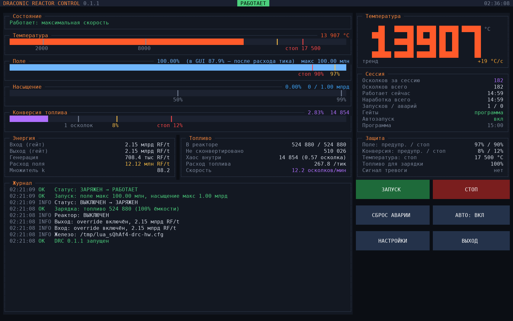
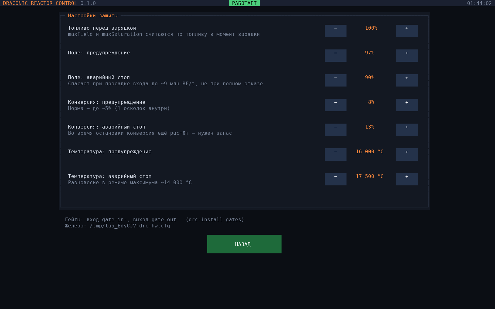

# DRC — Draconic Reactor Control (GTNH)

Программа для OpenComputers, которая ведёт [Draconic Reactor](https://wiki.gtnewhorizons.com/wiki/Draconic_Reactor)
в режиме **максимальной скорости** (Method 1 с вики): оба flux gate на максимуме, насыщение около 0%,
реактор сам выходит на ~13 900 °C и делает **~12 хаос-осколков в минуту**. Программа заряжает и запускает
реактор, держит гейты на уставке и аварийно гасит его по полю, конверсии и температуре.
Интерфейс на русском, с тач-кнопками, 160×50 (T3).

Один компьютер — один реактор. Механика сверена с исходником `GTNewHorizons/Draconic-Evolution`
(`TileReactorCore`, `TileReactorStabilizer`, `TileFluxGate`).




## Железо

| Блок | Где | Зачем |
|---|---|---|
| Reactor Core + 4 Reactor Stabilizer + Reactor Energy Injector | стабилизаторы и инжектор на одной оси с ядром, 4–8 блоков от него, смотрят на ядро | сам реактор |
| Flux gate **вход** | за инжектором (с его тыльной стороны) | источник RF → инжектор. Фиолетовая сторона к источнику, оранжевая к инжектору |
| Источник RF | к фиолетовой стороне входного гейта | должен **сам толкать** RF: гейт не тянет |
| Flux gate **выход** | за одним из стабилизаторов (с тыльной стороны) | стабилизатор → мусорка. Фиолетовая к стабилизатору |
| Energy trash can (мусорка) | к оранжевой стороне выходного гейта | принимает всё, что выдаёт реактор (~0.7M RF/t) |
| Adapter | вплотную к стабилизатору или инжектору | компонент `draconic_reactor` |
| Adapter × 2 | вплотную к каждому гейту | компоненты `flux_gate` |
| Компьютер | T3 case, APU T3 (или CPU T3 + GPU T3), RAM T3.5, HDD, OpenOS, **экран T3** | — |

**Зачем мусорка.** Скорость упирается в насыщение: чем оно ниже, тем горячее реактор и тем выше k
(на 14 000 °C ~88, на 8000 °C — 1). Насыщение уменьшается только тем, что стабилизатор отдаёт RF
в блок за собой. Если отдавать некуда, насыщение растёт к 100%, реактор остывает к ~2000 °C, и осколки
идут в десятки раз медленнее (это не опасно). В GTNH RF не переводится в EU, так что мусорка — самый простой приёмник.

**Топливо и осколки — снаружи** (как на вики): транслокаторы кладут пробуждённый дракониум в стабилизатор,
кондуит вынимает осколки. При 12 осколках/мин это **~32 блока дракониума в секунду**. Программа следит
за конверсией: если подача отстаёт или осколки не вынимаются, она гасит реактор.

**Чанки.** Реактор, гейты, источник и компьютер должны быть в одном прогруженном чанклоадером месте.

## Установка

Нужна интернет-карта:

```
wget -f https://raw.githubusercontent.com/EugenPrinz/draconic_reactor_program/main/install.lua /home/drc-install.lua
drc-install
```

Установщик:
1. Скачивает `drc.lua` в `/home`, проверяет, что файл целый и компилируется (старая версия — `drc.lua.bak`).
2. Проверяет железо: экран 160×50, `draconic_reactor`, два `flux_gate`.
3. **Определяет входной гейт:** открой GUI входного гейта и **увеличь** нижнюю уставку на любой шаг —
   установщик поймает, у какого гейта она изменилась, второй станет выходным. Enter — выбрать номером.
4. По желанию — redstone-сигнал тревоги и автозапуск в `/home/.shrc`.

```
drc-install update   # обновить программу (гейты и настройки сохраняются)
drc-install gates    # заново определить гейты
drc                  # запуск
```

Гейты и железо хранятся в `/home/drc-hw.cfg`, пороги и статистика — в `/home/drc.cfg`,
предупреждения и аварии дописываются в `/home/drc.log`.

## Как работает

1. **Ожидание топлива.** Зарядка начинается, когда в реакторе ≥ 100% ёмкости (524 880, настраивается):
   max поле и max насыщение фиксируются по топливу в момент зарядки, неполная загрузка навсегда (до
   следующего запуска) уменьшает их.
2. **Гейты.** Оба переводятся на override **2 147 483 647 RF/t** (максимум `int`). Каждые 5 с программа
   проверяет уставку и возвращает её, если кто-то поменял. Числа передаются дробными: в `TileGate` стоит
   каст `(Double) args[0]`, целое из Lua 5.3 дало бы ClassCastException.
3. **Зарядка → запуск.** `chargeReactor`, потом `activateReactor`, как только статус `charged`
   (с бесконечным источником — за ~0.5 с). Если зарядка стоит 20 с — предупреждение «нет RF на входе».
4. **Работа.** Опрос 5 раз в секунду. Аварийный стоп (`stopReactor`) если:
   - поле < **90%** (норма ~100%) — **поле до расхода тика**: `(fieldStrength + fieldDrainRate) / max`;
   - конверсия ≥ **12%** (норма до ~5%: один осколок внутри);
   - температура ≥ **17 500 °C** (равновесие ~13 900 °C; около 20 000 °C формула температуры уходит в разнос).
5. **Остановка.** Выход стабилизаторов прекращается сам, насыщение растёт до 99%, потом реактор остывает
   до 2000 °C и выключается — **~5 минут**. Вход всё это время на максимуме.
6. **После аварии** реактор сам не запускается: «СБРОС АВАРИИ», потом «ЗАПУСК».

Кнопки: **ЗАПУСК**, **СТОП** (двойное нажатие), **СБРОС АВАРИИ**, **АВТО** (сам заряжать и запускать),
**НАСТРОЙКИ** (пороги), **ВЫХОД** (двойное нажатие или Ctrl+Alt+C). При выходе реактор **продолжает
работать**, гейты остаются на максимуме, но защиты больше нет.

## Почему в GUI поле ~88%, а программа пишет 100%

OC (и GUI реактора) читают поле уже после расхода тика. Вход каждый тик доливает поле до максимума,
расход сразу снимает `fieldDrainRate` — на 14 000 °C это ~12M из 100M. Поэтому при бесконечном входе
в GUI видно ~88%, и это норма. Программа сравнивает с порогами поле до расхода: ~100%, пока вход держит.
(В 0.1.0 сравнивалось значение из GUI, и порог 90% давал ложную аварию через пару секунд после запуска.)

## Почему остановка такая долгая (~5 мин)

Это механика мода (`TileReactorCore.runTick`, статус STOPPING). Стабилизаторы перестают отдавать RF,
и насыщение растёт только от генерации самого реактора: `(1 − s) × 1.5M × (1 + 2c)` RF/t — экспонента,
с 0% до 99% около 4 минут. Пока насыщение ниже 99%, температура падает медленно (по обычной формуле);
с 99% реактор остывает на `1 − c` ≈ 1.27 °C/тик (~25 °C/с) до 2001 °C и выключается. Ускорить нечем,
опасности нет: поле всё время ~100%. Программа показывает оценку «насыщение 99% через ~N».

## От чего программа защищает, а от чего нет

Проверено офлайн-симулятором (`tests/sim.lua`, физика 1:1 из мода):

| Сбой | Что будет |
|---|---|
| Перестало поступать топливо | стоп на 12%, пик конверсии 14.2%, реактор погас через 5 мин ✔ |
| Перестали вынимать осколки | стоп на 12%, пик 14.2%, погас ✔ |
| Источник просел до 10–14M RF/t | стоп по полю, поле падает до 34–45%, погас ✔ |
| Источник просел ниже ~10M RF/t | **взрыв**, программа не успевает: после стопа насыщению нужны минуты, чтобы снизить расход поля |
| Вход пропал полностью | **взрыв за ~8 тиков** (поле 100M, расход ~12.5M RF/t) |
| Компьютер выключился / программа закрыта | реактор работает дальше с гейтами на максимуме, но без защиты |

Главная защита в режиме максимума — **надёжность входа**: источник, гейт и чанклоадер. Если хочется
запаса по времени, нужен режим с ограничением температуры: на 8000 °C поле продержится без входа ~18 с,
но осколки пойдут примерно в 90 раз медленнее.

Взрыв в коде мода один: `fieldCharge <= 0`. Ломать инжектор или стабилизаторы при T ≥ 2000 °C нельзя
(структура станет неверной, поле некому держать).

## Тесты

```
lua5.3 tests/sim.lua all            # 10 сценариев: basic starve noextract weakin inputloss resume ctrlc manual settings nogates
lua5.3 tests/install_test.lua       # установщик
DRC_DUMP=/tmp/s.txt lua5.3 tests/sim.lua basic && python3 tests/render.py /tmp/s.txt docs/screen-main.png
```

Параметры конфига в симуляторе — как в GTNH (по вики): `maxFuelStorage` 524 880, `FuelUsageMultiplier` 3035,
`EnergyOutputMultiplier` 1, нелинейный расход. Симулятор считает каждый вызов компонента за 1 тик.

## 3D-схема постройки

Интерактивная схема (three.js, текстуры из Draconic Evolution и OpenComputers): пошаговая сборка,
проверка расстояний и ориентации гейтов, живая модель реактора со сбоями — `docs/build.html` (открыть в браузере, нужен интернет для three.js). Сборка — `tools/build3d/`.
